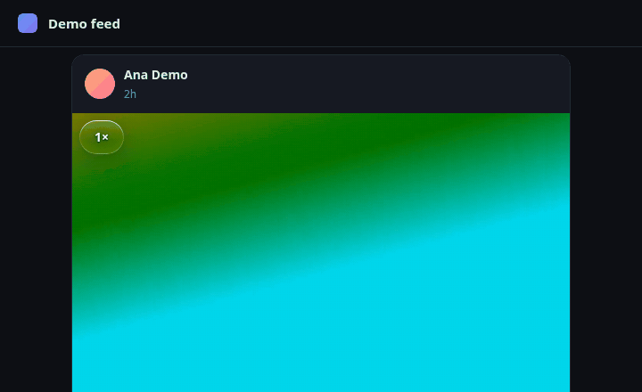
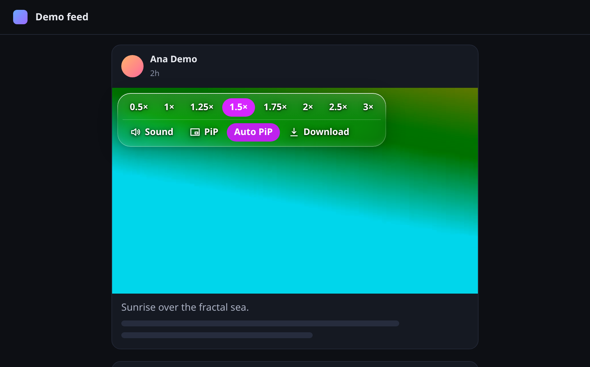
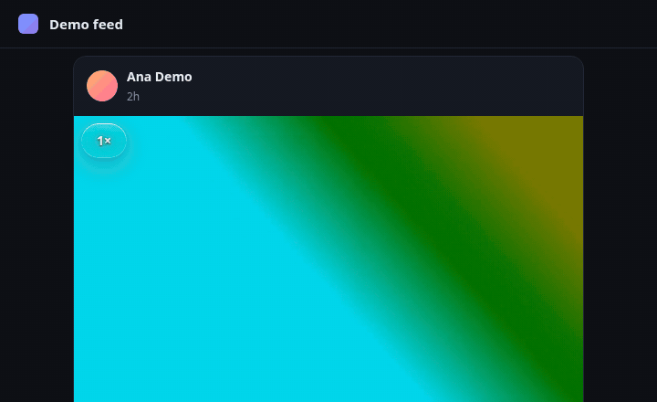
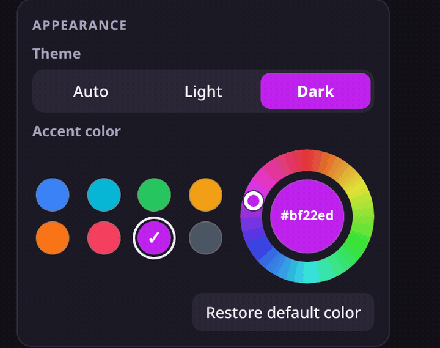
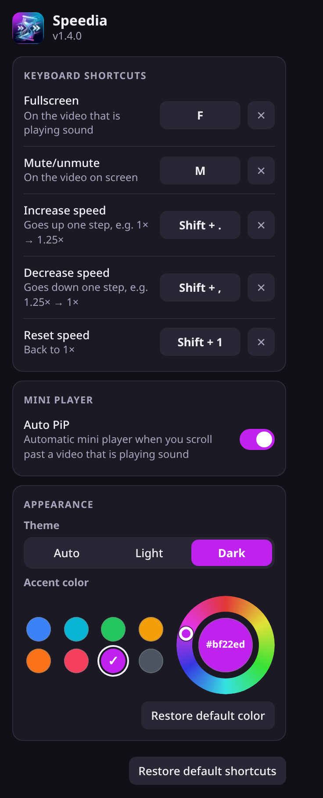
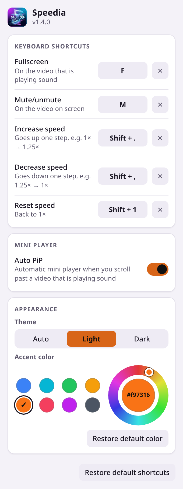
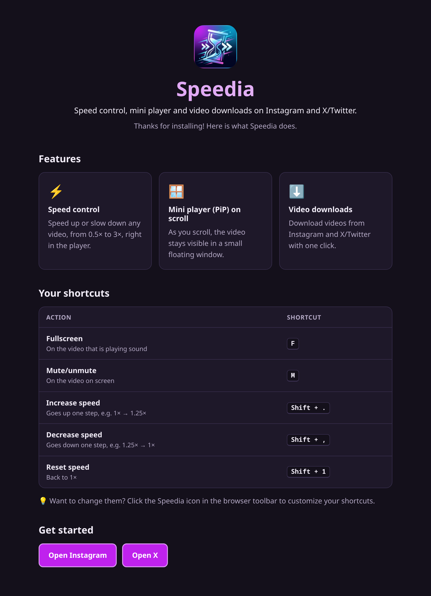

  

<h1 align="center">Speedia</h1>

  Speed control, mini player and download for videos on Instagram and X (Twitter).

  
  
  

English · <a href="README.pt-BR.md">Português</a>

  

## Features

- Playback speed from 0.5x to 3x, from a glass bar over the video.
- Mute and Picture-in-Picture buttons on the same bar.
- Auto PiP: a mini player appears when you scroll past a video that is playing with sound.
- Video download.
- Configurable keyboard shortcuts.
- Light, dark or automatic theme, with a customizable main color.
- The bar stays visible in fullscreen on X.
- Welcome page on install.
- Portuguese (BR) and English.

Works on Instagram and X/Twitter. Requires Chrome 121+ or Firefox 128+.

## Install

### Chrome

1. Download `speedia-vX.zip` from the [latest release](https://github.com/Glerme/Speedia/releases/latest) and extract it.
2. Open `chrome://extensions` and turn on **Developer mode**.
3. Click **Load unpacked** and select the extracted `speedia` folder.
4. Reload any Instagram or X tabs that are already open.

### Firefox

Open the signed `.xpi` from the [latest release](https://github.com/Glerme/Speedia/releases/latest) in Firefox and confirm the installation. It updates itself on every new release.

### Editions

- **Full** (GitHub releases): includes video downloads.
- **Store** (Chrome Web Store / AMO): same extension without video downloads and without the `downloads` permission.

Build either one with `scripts/build.sh <full|store> <outdir>` (e.g. `scripts/build.sh store dist` → `dist/speedia-store` and `dist/speedia-store-firefox`).

## Usage

Open a video on Instagram or X. The Speedia bar appears over it with the speed options (0.5x to 3x) and the mute, PiP, Auto PiP and download buttons.

  

- **Mini player:** with Auto PiP on, scrolling past a video that is playing with sound keeps it playing in a mini player.

  

    
  

- **Download:** the download button saves the video as an `.mp4` file.
- **Fullscreen:** the bar stays visible in fullscreen on X. Press `F` to toggle fullscreen.

## Keyboard shortcuts

| Action | Default |
| --- | --- |
| Fullscreen | `F` |
| Mute / unmute | `M` |
| Increase speed | `Shift` + `.` |
| Decrease speed | `Shift` + `,` |
| Reset speed | `Shift` + `1` |

You can change or disable any shortcut in the popup (click the Speedia icon in the toolbar). The popup warns about conflicts and lets you undo.

## Appearance

In the popup, choose the theme (Auto, Light or Dark) and the main color, from 8 presets or a color wheel. The bar over the video and the welcome page follow your choice.

  

  
  

## Welcome page

A small page opens after installation, listing the features and shortcuts.

  

## Privacy

Speedia does not collect any data and has no servers. Everything runs in your browser. It requests only two permissions: `downloads` (to save videos) and `storage` (to keep your settings). On Firefox, the manifest declares `data_collection_permissions: none`.

## Development

- **Run locally:** run `npm ci` and `npm run build` (or `npm run watch`), then load the `dist/` folder as an unpacked extension (`chrome://extensions` → Developer mode → Load unpacked; in Firefox, `about:debugging#/runtime/this-firefox` → Load Temporary Add-on).
- **Media:** the images and GIFs in `docs/media/` are regenerated with the scripts in `scripts/media`.
- **Release:** pushing a `v*` tag triggers [`release.yml`](.github/workflows/release.yml), which publishes the Chrome zip and the signed Firefox `.xpi`, plus `updates.json` for automatic updates. The release only goes out if `CHANGELOG.md` has a `## <version>` section for it, and the `version` in `static/manifest.json` must match the tag (e.g. tag `v1.4.0` ↔ version `1.4.0`).
