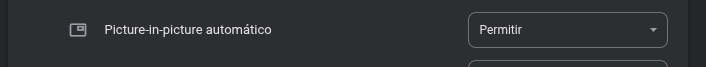

  

<h1 align="center">Speedia</h1>

  Speed control, mini player and download for videos on Instagram, X (Twitter), TikTok, Facebook and Reddit.

  
  
  

English · <a href="README.pt-BR.md">Português</a>

  

## Features

- Playback speed from 0.5x to 3x, from a glass bar over the video.
- Mute and Picture-in-Picture buttons on the same bar.
- Auto PiP: a mini player appears when you scroll past a video that is playing with sound.
- PiP on tab switch (optional, Chrome only): the playing video opens in Picture-in-Picture when you switch tabs. Chrome also requires allowing the site once, using the popup's "Allow this site" button.
- Video download.
- Always active, with the same bar on every site.
- Configurable keyboard shortcuts.
- Light, dark or automatic theme, with a customizable main color.
- The bar stays visible in fullscreen on X.
- Welcome page on install.
- New version notice (Chrome, GitHub zip): the icon shows a NEW badge and the popup links to the release.
- Portuguese (BR) and English.

Works on Instagram, X/Twitter, TikTok, Facebook and Reddit. Requires Chrome 121+ or Firefox 128+.

## Install

### Chrome

1. Download `speedia-vX.zip` from the [latest release](https://github.com/Glerme/Speedia/releases/latest) and extract it.
2. Open `chrome://extensions` and turn on **Developer mode**.
3. Click **Load unpacked** and select the extracted `speedia` folder.
4. Reload any Instagram, X, TikTok, Facebook or Reddit tabs that are already open.

This install does not update itself. Once a day Speedia checks GitHub for a new release; when there is one, the icon shows a **NEW** badge and the popup links to the download. To update, extract the new zip over the same folder and click the reload button on the extension card in `chrome://extensions`.

### Firefox

Open the signed `.xpi` from the [latest release](https://github.com/Glerme/Speedia/releases/latest) in Firefox and confirm the installation. It updates itself on every new release.

### Editions

- **Full** (GitHub releases): includes video downloads.
- **Store** (Chrome Web Store / AMO): same extension without video downloads and the new version notice, and without the `downloads` and `alarms` permissions.

Build either one with `scripts/build.sh <full|store> <outdir>` (e.g. `scripts/build.sh store dist` → `dist/speedia-store` and `dist/speedia-store-firefox`).

## Usage

Open a video on Instagram, X, TikTok, Facebook or Reddit. The Speedia bar appears over it with the speed options (0.5x to 3x) and the mute, PiP, Auto PiP and download buttons.

  

- **Mini player:** with Auto PiP on, scrolling past a video that is playing with sound keeps it playing in a mini player.

  

    
  

- **PiP on tab switch** (Chrome only): when you switch tabs, the video playing with sound opens in Picture-in-Picture. Chrome blocks this until you allow the site, and only you can do that (extensions can't change this permission). Do it once for each site (Instagram, X, TikTok, Facebook and Reddit):
  1. Open Instagram, X, TikTok, Facebook or Reddit and click the Speedia icon to open the popup.
  2. Under Mini player, turn on **PiP on tab switch**.
  3. Click **Allow this site**. Chrome's settings page for that site opens.
  4. Find **Automatic picture-in-picture** and set it to **Allow**.

     

  5. Go back to the site's tab and reload it. Play a video with sound and switch tabs.

  Or from Chrome's menu: `chrome://settings/content/autoPictureInPicture` > Allowed to enter picture-in-picture automatically > Add > `https://www.instagram.com` (or `https://x.com`, `https://www.tiktok.com`, `https://www.facebook.com`, `https://www.reddit.com`).

- **Download:** the download button saves the video as an `.mp4` file.
- **Fullscreen:** the bar stays visible in fullscreen on X. Press `F` to toggle fullscreen.

## Keyboard shortcuts

| Action | Default |
| --- | --- |
| Fullscreen | `F` |
| Mute / unmute | `M` |
| Increase speed | `Shift` + `.` |
| Decrease speed | `Shift` + `,` |
| Reset speed | `Shift` + `1` |

You can change or disable any shortcut in the popup (click the Speedia icon in the toolbar). The popup warns about conflicts and lets you undo.

## Appearance

In the popup, choose the theme (Auto, Light or Dark) and the main color, from 8 presets or a color wheel. The bar over the video and the welcome page follow your choice.

  

  
  

## Welcome page

A small page opens after installation, listing the features and shortcuts.

  

## Privacy

Speedia does not collect any data and has no servers. Everything runs in your browser, only on the 5 supported sites (Instagram, X, TikTok, Facebook and Reddit). Downloads come straight from the site's CDN, never through a Speedia server. On Chrome, the GitHub edition asks the public GitHub API for the latest version number once a day, sending no data of yours (the store edition and Firefox don't, since they update on their own). It requests four permissions: `activeTab` (reads the current tab's address only for the "Allow this site" button), `alarms` (schedules the daily version check), `downloads` (to save videos) and `storage` (to keep your settings). On Firefox, the manifest declares `data_collection_permissions: none`.

## Development

- **Run locally:** run `npm ci` and `npm run build` (or `npm run watch`), then load the `dist/` folder as an unpacked extension (`chrome://extensions` → Developer mode → Load unpacked; in Firefox, `about:debugging#/runtime/this-firefox` → Load Temporary Add-on).
- **Media:** the images and GIFs in `docs/media/` are regenerated with the scripts in `scripts/media`.
- **Release:** pushing a `v*` tag triggers [`release.yml`](.github/workflows/release.yml), which publishes the Chrome zip and the signed Firefox `.xpi`, plus `updates.json` for automatic updates. The release only goes out if `CHANGELOG.md` has a `## <version>` section for it, and the `version` in `static/manifest.json` must match the tag (e.g. tag `v1.4.0` ↔ version `1.4.0`).
